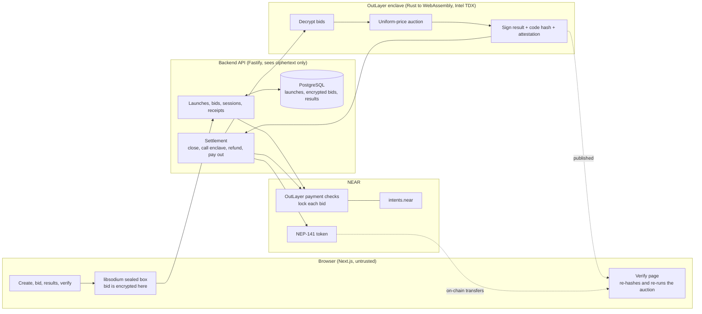
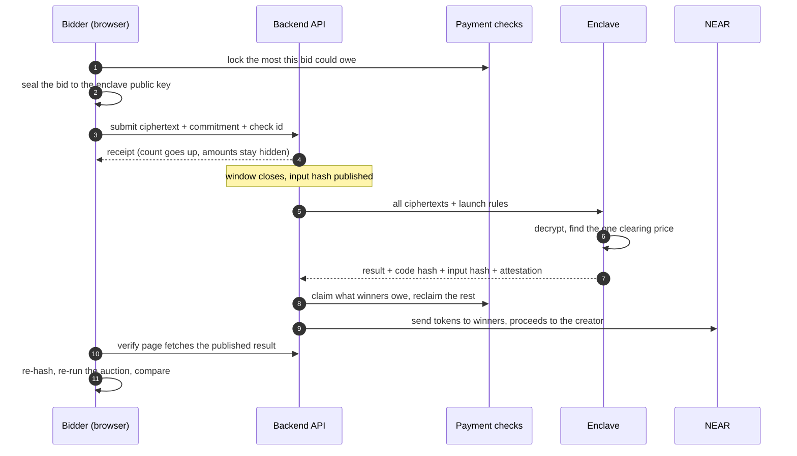

<p align="center"></p>

<h1 align="center">Unmask</h1>

<p align="center"><b>The token launch where bots lose their edge.</b><br/>
<b>Bid blind, win fair, check everything.</b><br/>
Sealed-bid token launches on NEAR: everyone pays one price, and anyone can verify the result.</p>

> Everyone bids blind, everyone pays the same clearing price, and the bids are unmasked only after the window closes, so anyone can check that the auction was run fairly.

| | |
|---|---|
| **Status** | Interface, the auction rule (TypeScript and Rust), in-browser bid sealing, wallet sign-in, the backend and settlement are built. We are now making the enclave, payment checks and the token real: **nothing here moves real funds yet.** |
| **Hackathon** | NEAR Hackathon, development 1–14 Nov 2026, submission by 14 Nov 23:59 UTC |
| **Tracks** | 11 Memecoins With Mechanics · 3 Privacy & Private AI · 4 Autonomous Business · 1 Unstoppable DeFi |
| **Stack** | Next.js 16 · React 19 · TypeScript · Tailwind CSS 4 · Fastify + PostgreSQL (Prisma) · libsodium · Rust → WebAssembly (planned) |

## Contents

[The problem](#the-problem) · [Why the name](#why-the-name) · [The idea](#the-idea) · [How a launch runs](#how-a-launch-runs) · [The auction rule](#the-auction-rule) · [What is real today](#what-is-real-today) · [The interface](#the-interface) · [Architecture](#architecture) · [NEAR protocols](#near-protocols) · [Getting started](#getting-started) · [Project structure](#project-structure) · [Documentation](#documentation) · [Limitations](#limitations)

## The problem

On most launchpads the first buyers win. Bots watch for a launch, buy in the first blocks, bundle wallets and sell into the people who arrive later. The advantage comes from **timing and visibility**: the price moves as people buy, so being first, or seeing other people's orders, pays.

## Why the name

Bids are masked while the window is open: nobody, the creator included, can read them. After the window closes the enclave **unmasks** them, finds one price and publishes proof. Unmask also describes the goal: bots lose their cover, and the launch can be inspected end to end.

## The idea

Take both advantages away.

- **Masked.** Buyers submit bids during a window, and nobody (the creator included) can read them until it closes. The public sees only how many bids there are.
- **One price.** When the window closes, a private auctioneer running in a hardware enclave (a TEE) finds the single price that sells the supply. Every winner pays it, not their own limit. Everyone else is refunded in full.
- **Provable.** The enclave publishes its code hash, the result and an attestation. Anyone can recompute the hashes, re-run the rule on the bids and check the transfers.

Arriving first or last changes nothing, so being fast stops being worth anything.

## How a launch runs

1. **Create.** The creator sets the token, the supply for sale, a reserve price, the bidding window and an optional cap per account. These are fixed from then on.
2. **Bid.** A buyer chooses a limit price and a quantity, locks the most they could owe in an OutLayer payment check, and submits the bid encrypted to the enclave.
3. **Close.** No more bids are accepted. The public still sees only a count.
4. **Settle.** The enclave opens the bids, finds the clearing price, sends tokens to winners, returns every unused amount and pays the creator.
5. **Verify.** The code hash, the input hash, the attestation and the on-chain transfers are checked against the published result.

## The auction rule

Uniform-price, sealed-bid. Sort bids by limit price, highest first, and fill them until the supply is sold. The **clearing price** is the limit of the last bid filled, even partly, or the reserve price if demand falls short of the supply. Every winner pays the clearing price. Bids at that price share what is left pro-rata, in whole tokens, with verifiable randomness for the rounding crumbs. A bid below the clearing price wins nothing and is refunded.

Example: 1,000,000 tokens for sale, reserve $0.01.

| Bidder | Limit price | Wants | Result |
|---|---|---|---|
| A | $0.05 | 400,000 | Filled |
| B | $0.04 | 300,000 | Filled |
| C | $0.03 | 300,000 | Filled (the last one) |
| D | $0.02 | 200,000 | Nothing, refunded in full |

The clearing price is **$0.03**. A pays $12,000 (not $0.05), B pays $9,000, C pays $9,000, and the creator receives $30,000. The rule is implemented in [`src/lib/auction.ts`](src/lib/auction.ts) and this example is one of its tests.

## What is built, and what we are making real

The work is split in two: what already runs, and what we are building next so that every part is real, end to end. Nothing here moves real funds yet.

**Built and working**

| Piece | State |
|---|---|
| The interface: every screen below, the animations and the drawings | Built |
| The auction rule, exact integers, in TypeScript and in Rust, matching on 12 shared cases | Built, tested ([`docs/auction-core-v1.md`](docs/auction-core-v1.md)) |
| Bid sealing in the browser (libsodium sealed box) and the commitment check | Built |
| NEAR wallet sign-in (signed challenge, sessions) | Built |
| Backend API (Fastify, PostgreSQL, Prisma): launches, bids, sessions, receipts, enclave key, settle, result | Built |
| Settlement: open bids, reject dishonest ones with a recorded reason, run the Rust engine, store and publish the result | Built, runs on one machine ([`docs/settlement-dev.md`](docs/settlement-dev.md)) |
| Hashing and re-running the auction on the verify page | Built, runs in your browser |

**Being made real next**

| Piece | Today | Target |
|---|---|---|
| The enclave that runs the auction | Runs in the backend process, so it is not confidential | The same Rust engine inside an OutLayer TEE |
| Attestation | Not produced; the result is labelled `dev` | A real attestation, verified on the verify page |
| Payment checks and funds | Locks nothing | Real OutLayer payment checks, claims and refunds |
| The token and payouts | Not deployed | A NEP-141 token with real payouts to winners |
| Live data on the landing page and launch cards | Sample launches | Launches read from the backend |

## The interface

Pure black, square boxes, pink for *masked*, green for *verified*, red for a bot or a failed check. Screens that show sample launches say so.

| Route | What it is |
|---|---|
| `/` | Landing: the sealed-envelope hero, the bots-versus-Unmask race, live meme cards, how it works, a clearing demo |
| `/launches` | Every launch, with stats and a filter |
| `/launches/[id]` | One launch in one of three states: bidding open (countdown, sealed stack, bid form), settling, or settled (clearing price, opened bids, proof hashes) |
| `/launches/new` | Create a launch, with a live preview |
| `/verify` | Five checks redone in the browser, with a "pretend someone cheated" switch |
| `/how-it-works` | The six steps, the rule with a worked example computed live, a glossary |
| `/compare` | The race, plus dials for how many bots are in the room and what they will pay |
| `/portfolio` | My bids: one open, one won, one lost, for a demo wallet |
| `/creators` | What a creator sets and gets |
| `/faq`, `/limits` | Short answers, and what this does not do |

## Architecture

Three trust zones. Only the enclave ever sees a bid in the clear, and everything it does can be checked by anyone.



**A launch, step by step**



| Zone | Sees | Can it cheat? |
|---|---|---|
| Browser | Its own bid | Only against itself |
| Backend | Ciphertexts, counts, results | It cannot read a bid, and it cannot change the result without breaking the hashes |
| Enclave | Every bid, only while settling | Limited by its public code hash and attestation |
| NEAR | Transfers | Public by design |

## NEAR protocols

| Protocol | Role | Status |
|---|---|---|
| OutLayer (TEE) | Runs the auctioneer as Rust compiled to WebAssembly, with an attestation | Researched |
| OutLayer payment checks | Lock each bid; refund what is not owed; gasless | Researched |
| OutLayer verifiable randomness | Rounding crumbs at the clearing price | Researched (briefly) |
| NEP-141 | The token being launched | Not started |
| NEAR Intents | The layer payment checks sit on; optional funding from other chains | Researched |

How the pieces fit together is in [`docs/near-integration.md`](docs/near-integration.md); the status of each is in [`docs/protocols-integrated.md`](docs/protocols-integrated.md). Nothing is integrated yet.

## Getting started

```sh
npm install
npm run dev          # the app, http://localhost:3000
npm test             # the auction rule, the race and the verify checks
npm run typecheck
npm run lint
npm run build
```

Rust engine and shared vectors:

```sh
cd enclave/auction-engine && cargo test     # must match shared/test-vectors on every case
npx tsx scripts/gen-test-vectors.ts          # regenerate the cases from the TypeScript rule
```

The backend lives in `backend/` and needs PostgreSQL:

```sh
cd backend
npm install
npx prisma migrate dev
npm run dev
```

Its write endpoints are for local development only: see [`docs/backend-phase2.md`](docs/backend-phase2.md).

Node.js 24 was used during development. This project's `AGENTS.md` asks you to read the guide in `node_modules/next/dist/docs/` before writing code, because this Next.js version has breaking changes. Two matter here: with Cache Components on, anything that depends on the clock lives in a client component, and a dynamic route's `params` is read inside a `Suspense` boundary.

## Project structure

```
src/
├── app/            Routes (see the table above), the theme (globals.css), the icon
├── components/     Nav, footer, cards, the race, the reveal chart, forms, the drawings (art.tsx)
└── lib/
    ├── auction.ts       The uniform-price sealed-bid rule
    ├── race.ts          The same bids as a first-come launch and a sealed one
    ├── verify-demo.ts   The checks the verify page runs
    └── demo.ts          Made-up launches and bids
backend/            Fastify + Prisma API: auth, launches, bids, receipts
enclave/            Rust auction engine (compiled to WebAssembly, in progress)
shared/             Test vectors shared by TypeScript and Rust
e2e/                Playwright smoke tests
docs/               Project documentation (below)
```

## Documentation

| File | What it covers |
|---|---|
| [`docs/what-we-are-building.md`](docs/what-we-are-building.md) | The product, the rule and a worked example |
| [`docs/near-integration.md`](docs/near-integration.md) | How OutLayer, payment checks, NEP-141 and NEAR Intents fit together |
| [`docs/plan.md`](docs/plan.md) | Scope, architecture, phases, tests and risks |
| [`docs/whats-done.md`](docs/whats-done.md) | What is finished and what is next |
| [`docs/protocols-integrated.md`](docs/protocols-integrated.md) | Each NEAR protocol and its status |
| [`docs/decisions-and-open-questions.md`](docs/decisions-and-open-questions.md) | Decisions to settle and open questions |
| [`docs/auction-core-v1.md`](docs/auction-core-v1.md) | The exact integer auction rule and its shared test vector |
| [`docs/settlement-dev.md`](docs/settlement-dev.md) | How a launch settles on one machine, and what is and is not real |
| [`docs/backend-phase2.md`](docs/backend-phase2.md) | The backend: invariants, trust boundary and next work |
| [`docs/api-contract.md`](docs/api-contract.md) | The HTTP API the interface talks to |
| [`docs/demo-script.md`](docs/demo-script.md) | The demo, step by step |
| [`docs/submission-checklist.md`](docs/submission-checklist.md) | What the hackathon form needs |

## Limitations

- It removes the timing and visibility advantage, **not** the wealth advantage: a rich buyer can still buy a lot, or split across wallets.
- Fairness rests on the enclave's attestation and on the enclave code being public. How to verify an OutLayer attestation is not yet confirmed.
- Enclave code must be Rust compiled to WebAssembly. OutLayer's fees and limits are not yet known.
- It promises no price, liquidity or returns. Token launches can be regulated in some places. This is a prototype.

## Team

| | Role | GitHub |
|---|---|---|
| **Ayush Singh** | Co-founder · CTO | [@ayushsingh82](https://github.com/ayushsingh82) |
| **Kaushal** | Co-founder · Engineering Lead | [@kaushal0398](https://github.com/kaushal0398) |

## License

To be decided.
